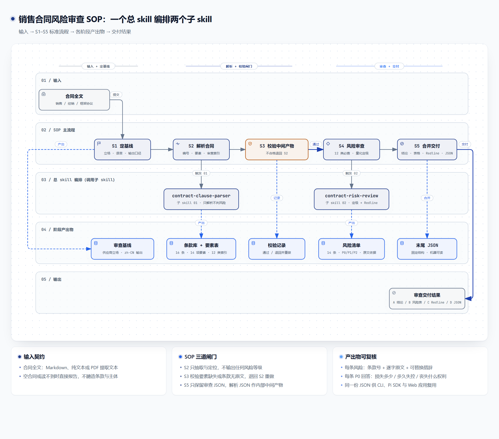
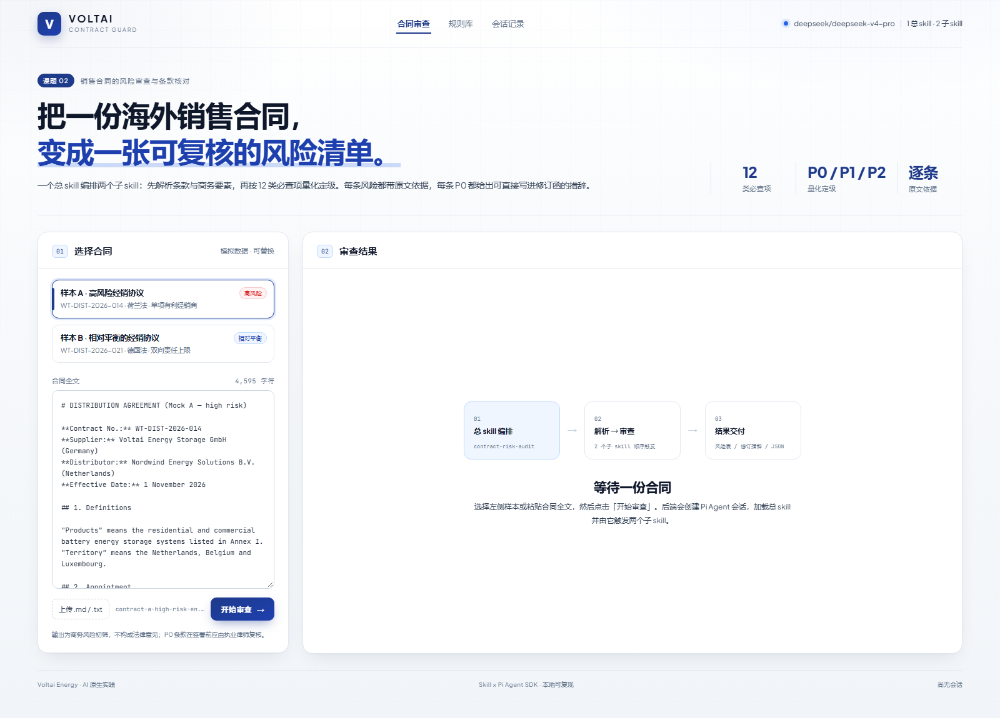
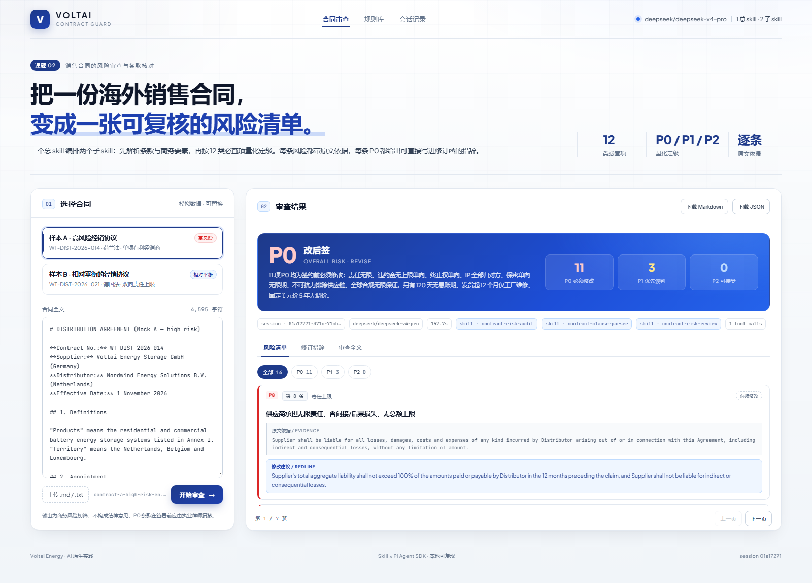
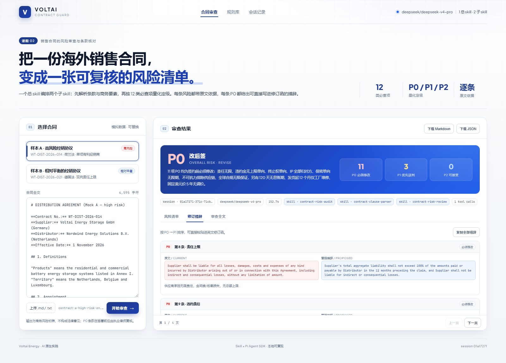
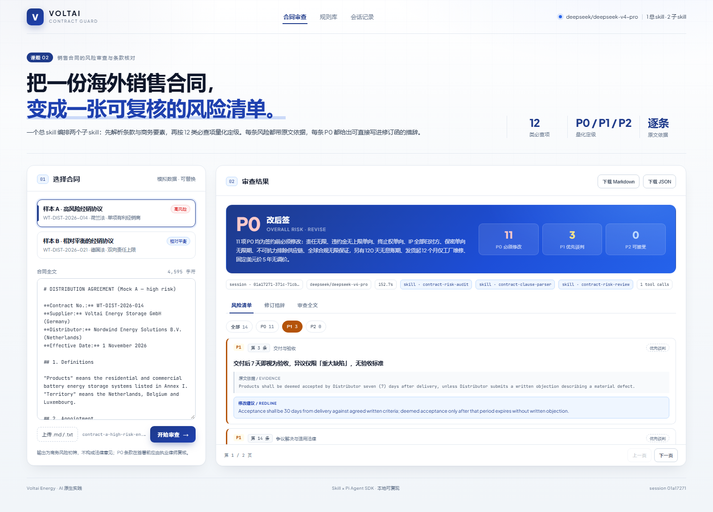

# Voltai Contract Guard

> 销售/经销合同的风险审查与条款核对 · **可执行 Agent Skill + Pi Agent SDK 示例 + Web 应用**

把「合同审查」从一段提示词，做成三层可复用的能力：**一个可被 Agent 直接调用的 skill 套件**、**一个可被程序调用的 SDK 流程**、**一个可给业务方直接用的界面**。同一个审查内核，在 CLI、SDK、Web 三种形态下给出一致结论。

<p align="center">
  
</p>

## 这个项目解决什么问题

法务/商务审合同，真正的问题不是「没人看」，而是**每次看的标准不一样**：

- 同一份经销协议，不同人抓到的风险点不同；结论停留在「我觉得有风险」，无法量化到「先改哪几条、不改会损失多少」。
- 大模型逐字通读时容易「读着读着开始猜」，把没约定的条款当成已约定，或引用的原文和条款对不上。
- 风险结论散落在聊天记录里，无法沉淀成可复算、可对比、可交付的结构化结果。

因此本项目的核心约束是：**结构先于判断，原文先于结论**。先解析成带条款号的结构化事实，再按固定阈值判级，最后才生成给人看的表述。

## 包含的 AI 产品

| # | 形态 | 位置 | 说明 |
|---|---|---|---|
| 1 | **合同审查 Skill 套件** | [`skills/`](skills/) | 1 个总编排 skill + 2 个子 skill：解析不判风险，审查不改原文；12 类必查、P0/P1/P2 量化定级、原文可追溯 |
| 2 | **Pi Agent SDK 示例** | [`examples/pi-sdk-ingest/`](examples/) | 用 SDK 在指定目录加载第三方 `llm-wiki` skill，把一篇文档按 Ingest 流程录入知识库并自检 |
| 3 | **Web 应用** | [`app/`](app/) | Node 原生 http 服务 + 原生前端，选择样本合同 → 真实调用 Agent → 渲染风险卡 / Redline / 全文，支持导出 JSON |

## 整体架构

```
┌─────────────────────────────────────────────────────────────┐
│  交互层    Web（app/public，原生 HTML/CSS/JS）                │
│            · 样本合同  · 风险卡  · Redline 对照  · 导出 JSON   │
├─────────────────────────────────────────────────────────────┤
│  应用层    app/server.mjs                                    │
│            · POST /api/review  → 组装提示词 → 调用 Agent      │
│            · 白名单加载 3 个 skill，禁止无关 skill 干扰         │
├─────────────────────────────────────────────────────────────┤
│  Agent层   @earendil-works/pi-coding-agent                   │
│            · DefaultResourceLoader（skill 发现与过滤）         │
│            · ModelRuntime（deepseek）· AgentSession（会话）    │
├─────────────────────────────────────────────────────────────┤
│  Skill层   skills/                                           │
│            contract-risk-audit（总入口：编排 / 校验 / 合并）   │
│              ├─ contract-clause-parser（解析：条款 / 14 要素） │
│              └─ contract-risk-review  （审查：12 类 / 定级）   │
├─────────────────────────────────────────────────────────────┤
│  事实层    docs/contracts（样本合同）· references/scoring-rubric│
└─────────────────────────────────────────────────────────────┘
```

设计取舍：

- **三层平级 skill 而非嵌套**：Pi SDK 与 kimi-code 的发现规则是「目录内有 `SKILL.md` 即视为 skill root」，物理嵌套会导致子 skill 不被独立加载；总 skill 用相对路径显式引用子 skill，实现逻辑封装。
- **规则与阈值集中在一处**：P0/P1/P2 只看金额、时限、权利丧失，阈值固化在 [`scoring-rubric.md`](skills/contract-risk-review/references/scoring-rubric.md)，不随模型每次重新发挥。
- **人机双读的输出**：正文给人看（结论 / 风险表 / Redline），末尾唯一一个 JSON 给程序看，CLI、SDK、前端共用同一结构。

## 快速开始

环境要求：Node.js ≥ 18；需要一个可用的 Pi Agent 模型凭证（`pi` 内执行 `/login`）。

```bash
git clone https://github.com/Petrichor1115/voltai-contract-guard.git
cd voltai-contract-guard
npm install
npm start          # 打开 http://localhost:4311
```

首次不配置模型也能看界面：

```
http://localhost:4311/?demo=1                 # 载入仓库内缓存的真实审查结果
http://localhost:4311/?demo=1&tab=redline     # 直接看 Redline 页
```

跑 SDK 示例（会真实调用模型，消耗 token）：

```bash
npm run example:ingest
```

跑语法自检（不依赖凭据、不消耗 token）：

```bash
npm run check
```

## 界面

| 首页：样本合同与执行入口 | 结果：P0 结论与风险卡 |
|---|---|
|  |  |

| Redline：原文 / 替换句对照 | 按等级过滤 |
|---|---|
|  |  |

审查全文（模型返回的完整报告）见 [app-05-fulltext.png](docs/screenshots/app-05-fulltext.png)；
CLI 与 SDK 的真实运行截图见 [kimi-cli.png](docs/screenshots/kimi-cli.png)、[pi-sdk.png](docs/screenshots/pi-sdk.png)。

## 目录结构

```
voltai-contract-guard/
├─ skills/                  # 产品 1：合同审查 skill 套件（含 scoring-rubric）
├─ app/                     # 产品 3：Web 应用（server.mjs + public + 缓存结果）
├─ examples/
│  └─ pi-sdk-ingest/        # 产品 2：Pi Agent SDK + llm-wiki 入库示例
├─ docs/
│  ├─ contracts/            # 样本 A（高风险）/ B（相对平衡）
│  ├─ prd/                  # 4 份 PRD（总览 + 三个页面）
│  ├─ design/               # skill 设计理念图（HTML / PNG）
│  ├─ screenshots/          # 应用、CLI、SDK 截图与原始运行日志
│  └─ 交付说明.md            # 完整交付复盘：设计取舍、执行证据、复现路径
├─ package.json
├─ LICENSE                  # MIT
└─ README.md
```

## 验证与证据

项目里保留的是**真实执行记录**，不是手写示例：

- CLI 原始输出（1000 行）：[kimi-cli-run-master.txt](docs/screenshots/kimi-cli-run-master.txt)
- SDK 原始输出：[pi-sdk-run.txt](docs/screenshots/pi-sdk-run.txt)
- 应用侧缓存结果（一次真实审查，14 项风险）：[demo-result.json](app/data/demo-result.json)

样本 A 的执行结果：16 条条款 / 14 项商务要素（3 项「未约定」）/ 12 类必查全覆盖 / 14 条风险（12 P0 · 1 P1 · 1 P2），结论「改后签」。

## 说明与边界

- 合同主体、金额、条款均为**模拟数据**，仅用于演示 skill 能力。
- 输出是商务风险初筛，不构成法律意见；P0 条款签署前应由执业律师复核。
- 仓库不含任何模型凭证；`auth.json` 只在 Pi 用户目录或系统临时目录中使用。
- 设计图由外部工具 `archify`（workflow 图）与 `ui-ux-pro-max`（设计系统）生成，两个工具未随仓库发布，仓库保留生成后的图与设计规范。

## License

[MIT](LICENSE) © 2026 Hedy

第三方组件：`examples/pi-sdk-ingest/.pi/skills/llm-wiki` 为 [Astro-Han/karpathy-llm-wiki](https://github.com/Astro-Han/karpathy-llm-wiki)（MIT），其许可证见该目录内 `LICENSE`。
