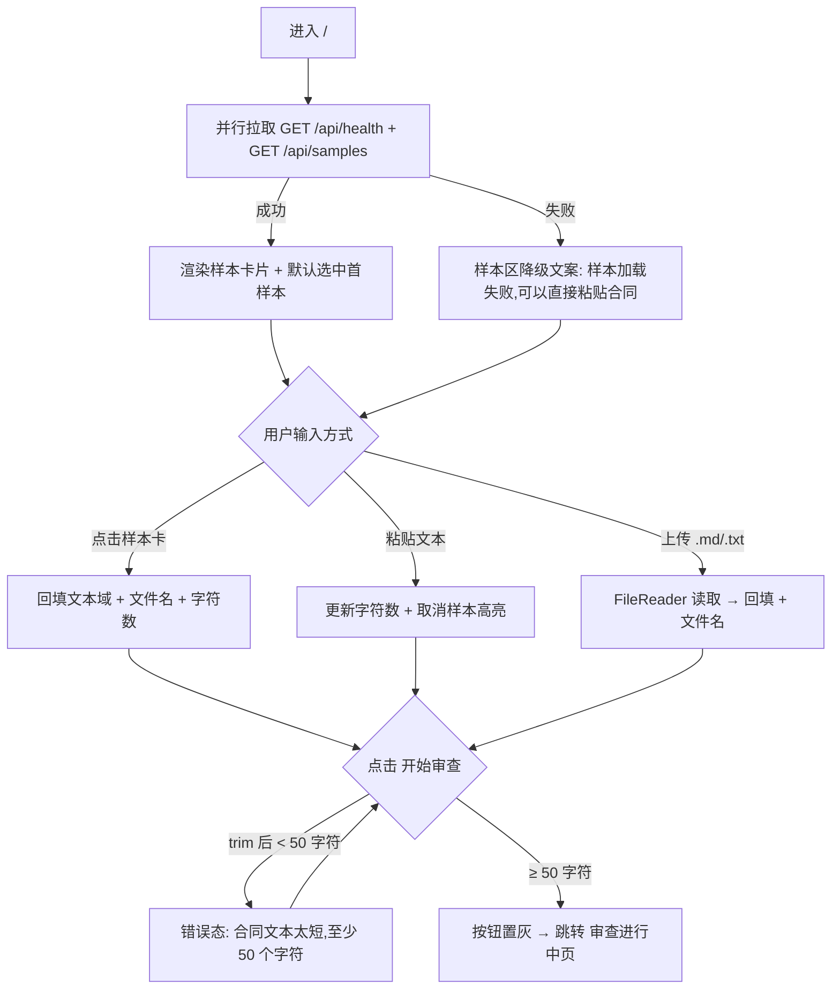

# PRD-01 · 子页面：合同输入页（等待态 idle）

> 隶属：合同风险审查系统（contract-risk-audit）Web 应用
> 路由：`/`（默认态）· 文档版本 v1.0 · 2026-10-26

---

## 1. 页面概述

### 1.1 定位

系统唯一入口页。用户在此完成「选择合同 → 确认文本 → 发起审查」三步动作，是整条审查链路（输入 → S1–S5 SOP → 交付）的起点。

### 1.2 业务目标

| 编号 | 目标 | 衡量口径 |
|---|---|---|
| G1 | 让用户在 10 秒内完成一次可执行的合同提交 | 从页面加载到点击「开始审查」的中位时长 ≤ 10s（样本合同路径） |
| G2 | 消灭无效提交 | 发起审查请求中，因文本过短被拦截的比例 ≤ 5% |
| G3 | 引导用户理解后端能力 | 页面可见区必须呈现「1 总 skill · 2 子 skill」与 12 类必查项提示 |

### 1.3 价值说明

把「通读半天合同」压缩为「选样本/粘贴 → 一键提交」；通过默认选中首个样本合同，保证新用户零输入成本即可走通全流程。

---

## 2. 目标用户与典型使用场景

| 角色 | 场景 | 关键动作 |
|---|---|---|
| 法务专员 | 收到 16 条款海外销售合同，签署前初筛 | 点选样本或粘贴合同全文 → 点击「开始审查」 |
| 销售业务员 | 谈判前想确认「该争什么」 | 上传 `.md/.txt` 合同文件 → 提交 |
| 演示/评审者 | 会场快速复现结果 | 打开 `/?demo=1` 直接进入结果态（本页仅作为承载，不发起真实审查） |

**不支持场景**（明确边界）：PDF 原生解析（仅支持 `.md/.txt/.markdown` 及粘贴文本）、多合同批量提交、未登录权限体系（系统无账号概念）。

---

## 3. 核心功能清单（分优先级）

| 编号 | 功能 | 优先级 | 接口依赖 | 跳转（源 → 目标） |
|---|---|---|---|---|
| F-01 | 样本合同卡片渲染（2 份，含「高风险/相对平衡」标签） | P0 | `GET /api/samples` | 输入页内：卡片点击 → 文本域回填 |
| F-02 | 默认选中首个样本并回填文本域与文件名 | P0 | `GET /api/samples` | 同上 |
| F-03 | 合同全文文本域 + 实时字符计数 | P0 | 无 | 输入页内：输入 → 计数刷新 |
| F-04 | 「开始审查」触发校验与提交 | P0 | `POST /api/review` | 输入页 → 审查进行中页（`idleState` → `loadingState`） |
| F-05 | 本地文件上传（.md/.txt/.markdown）回填 | P1 | 无 | 输入页内：选择文件 → 文本域回填 |
| F-06 | 健康状态展示（模型名、skill 数） | P1 | `GET /api/health` | 无跳转 |
| F-07 | 免责声明固定展示 | P1 | 无 | 无 |
| F-08 | 样本加载失败降级提示 | P1 | `GET /api/samples` 失败 | 无 |
| F-09 | URL 参数预置（`?tab=` `?filter=` `?demo=1`） | P1 | `GET /api/demo-result` | 输入页 → 审查结果页（demo 模式跳过 loading） |
| F-10 | 顶部导航「规则库 / 会话记录」占位 | P2 | 无 | 无（当前置灰不可点） |
| F-11 | 手动清空样本选中态（编辑文本即取消高亮） | P2 | 无 | 无 |

**验收标准（可量化）**

- F-01/F-02：`GET /api/samples` 成功后 300ms 内渲染 2 张卡片，首张自动带 `active` 高亮，文本域字符数 = 样本 `text` 去首尾空白长度，文件名显示 `contract-a-high-risk-en.md`。
- F-03：任意输入后 100ms 内计数刷新为 `${n.toLocaleString()} 字符`（`n` = 去首尾空白后长度）。
- F-04：`contract.trim().length < 50` 时**不得**发出网络请求，直接进入错误态并显示「合同文本太短，至少 50 个字符。」；≥50 时发出 1 次 POST，且「开始审查」按钮置灰直至请求结束。
- F-09：`?demo=1` 存在时不展示 loading 态，直接渲染结果态；失败进入错误态并显示「演示结果未就绪：{原因}」。

---

## 4. 页面交互流程图

**状态跳转源/目标清单**

| 源 | 目标 | 触发条件 |
|---|---|---|
| `#/` 输入页（`#idleState`） | 审查进行中页（`#loadingState`） | 点击「开始审查」且校验通过 |
| `#/` 输入页 | 错误态（`#errorState`） | 文本 < 50 字符 / 请求异常 / demo 数据缺失 |
| `#/` 输入页 | 审查结果页（`#resultState`） | 仅 `?demo=1` 直达 |
| 顶部品牌块 `href="/"` | 输入页（整页刷新） | 点击品牌块 |

---

## 5. 字段与表单规则

| 字段 / 控件 | ID | 类型 | 默认值 | 校验规则 | 格式限制 |
|---|---|---|---|---|---|
| 合同全文 | `#contractText` | textarea | 首个样本的 `text`（样本接口失败时为空串） | 提交前 `trim()` 后长度 ≥ 50，否则拦截；无上限校验 | `spellcheck=false`；placeholder「粘贴英文或中文合同全文，或从上方选择一个样本合同…」 |
| 字符计数 | `#charCount` | span | `0 字符` | 实时跟随 `input` 事件 | 展示格式 `${n.toLocaleString()} 字符` |
| 文件名 | `#filename` | span | `contract-a-high-risk-en.md` | 上传成功后替换为 `file.name`；粘贴文本不修改该值 | 仅展示，随请求作为 `filename` 出参 |
| 文件选择 | `#fileInput` | file | 空 | `accept=".md,.txt,.markdown"`；取消选择不触发任何变更 | `FileReader.readAsText`，UTF-8 |
| 样本卡片 | `.sample[data-id]` | div | 首张 `active` | 点击即选中（单选），手动编辑文本域后取消全部选中 | 标签文案：`id === "high-risk"` → 「高风险」，否则「相对平衡」 |
| 提交按钮 | `#runBtn` | button | 可用 | 请求进行中 `disabled=true`，`finally` 恢复 | 文案「开始审查 →」 |
| 提交契约 | — | JSON body | — | `{ contract: string(trim 后), filename: string }` | `content-type: application/json` |

---

## 6. 全链路异常处理

| 编号 | 异常 | 触发条件 | 提示文案（逐字） | 处理与降级 |
|---|---|---|---|---|
| E-01 | 文本过短 | `trim().length < 50` | `合同文本太短，至少 50 个字符。` | 切换至错误态（右侧面板），不发请求；提供「重新执行」按钮回到同一校验 |
| E-02 | 样本接口失败 | `/api/samples` 网络失败或非 JSON | `样本加载失败，可以直接粘贴合同。` | 样本区显示红色降级文案（10px/#c0392b）；文本域保持空，用户可粘贴；不阻塞提交 |
| E-03 | 健康检查失败 | `/api/health` 失败 | 无文案 | `#modelName` 保持兜底文案「Pi Agent SDK」；不影响其他功能 |
| E-04 | 审查接口失败 | `res.ok === false` | `data.error`，缺省 `服务端执行失败` | 切换至错误态；按钮恢复可用 |
| E-05 | 结果缺 JSON | `data.result` 为空 | `模型返回了文本，但没有找到结构化的 JSON 结果。请查看「审查全文」或重试。` | 切换至错误态；按钮恢复可用 |
| E-06 | demo 数据缺失 | `?demo=1` 且 `/api/demo-result` 失败或含 `error` | `演示结果未就绪：{原因}` | 切换至错误态 |
| E-07 | 文件读取异常 | FileReader 非文本/空文件 | 无提示（P1 项：后续补充「文件读取失败，请重试」toast） | 文本域与文件名保持原值 |

**降级原则**：任何单点接口失败不得阻塞「粘贴文本 → 提交」主路径；错误态必须保留「重新执行」入口（`#retryBtn` → 重新调用 `runReview`）。

---

## 7. 数据埋点需求（全节点）

> 现状：前端暂无埋点 SDK；本节为规划新增（P1）。上报通道建议 `navigator.sendBeacon` / 统一 `POST /api/track`，失败静默。

| 事件名 | 触发条件 | 上报参数 |
|---|---|---|
| `page_view_input` | 页面首次加载完成（`init()` 执行完毕） | `page=input`、`url_params`（tab/filter/demo 是否存在）、`ts` |
| `sample_loaded` | `/api/samples` 成功返回 | `count`（样本数）、`first_id`、`duration_ms` |
| `sample_load_fail` | `/api/samples` 失败 | `error_type`（network/parse） |
| `sample_click` | 点击样本卡片 | `sample_id`、`char_count` |
| `contract_paste_or_input` | 文本域 `input` 事件（≥300ms 防抖后） | `char_count`、`has_sample_selected`（此时必为 false） |
| `file_upload` | 文件选择并读取成功 | `file_ext`、`file_size_bytes`、`char_count` |
| `review_submit` | 点击「开始审查」且通过校验、发出 POST 前 | `char_count`、`filename`、`source`（sample/paste/upload） |
| `review_submit_block` | 点击「开始审查」但 <50 字符被拦截 | `char_count` |
| `review_result` | 收到 200 且含 `result` | `elapsed_ms`、`model`、`risk_count`、`p0_count`、`session_id` |
| `review_error` | 进入错误态（E-01/04/05/06） | `error_code`（E-01…E-07）、`message` |

---

## 8. 多端兼容性与性能要求

| 维度 | 要求 |
|---|---|
| 浏览器 | Chrome/Edge ≥ 110、Firefox ≥ 110、Safari ≥ 16（依赖 ResizeObserver、`hidden` 属性、Clipboard API） |
| 响应式断点 | >1180px 左右双栏（左栏 402px）；≤1180px 上下堆叠；≤720px 单列（复用全局断点） |
| 字体 | Google Fonts（Plus Jakarta Sans / JetBrains Mono）加载失败时回落系统无衬线，**不得**阻塞渲染（`display=swap`） |
| 首屏性能 | `GET /api/samples` + `GET /api/health` 并行请求；卡片渲染 ≤ 300ms（接口返回后）；LCP ≤ 1.5s（本地服务） |
| 交互性能 | 字符计数、样本点击回填 ≤ 100ms；文本域输入防抖 300ms |
| 无障碍 | 禁用态按钮 `disabled` 属性；免责声明常驻可见；文本域有可见 label「合同全文」 |
| 安全 | 文本域渲染前统一 `escapeHtml`；上传仅本地 `FileReader` 读取，不做二次校验（P2：增加大小上限 2MB） |

---

## 9. 接口依赖明细

| 接口 | 方法 | 入参 | 出参 | 失败语义 |
|---|---|---|---|---|
| `/api/samples` | GET | 无 | `{ samples: [{ id, title, subtitle, file, text }] }` | 非 200/JSON → E-02 |
| `/api/health` | GET | 无 | `{ model: string, skills: string[] }` | 静默降级 E-03 |
| `/api/review` | POST | `{ contract, filename }` | `{ markdown, result{...}, model, sessionId, skills, toolCalls, elapsed_ms }` | 4xx/5xx → E-04；200 无 result → E-05 |

> `result` 完整结构见 PRD-03 §9。本页只负责构造请求并切换到 loading 态，不消费响应内容。

---

## 10. 边界条件汇总

| 支持场景 | 不支持场景 |
|---|---|
| 选择样本、粘贴中英文文本（≥50 字符）、上传 .md/.txt/.markdown、`?demo=1` 直达结果 | PDF/DOCX 原生解析；批量多合同；<50 字符提交；无网络时提交（将命中 E-04）；「规则库/会话记录」导航跳转（P2 占位） |
