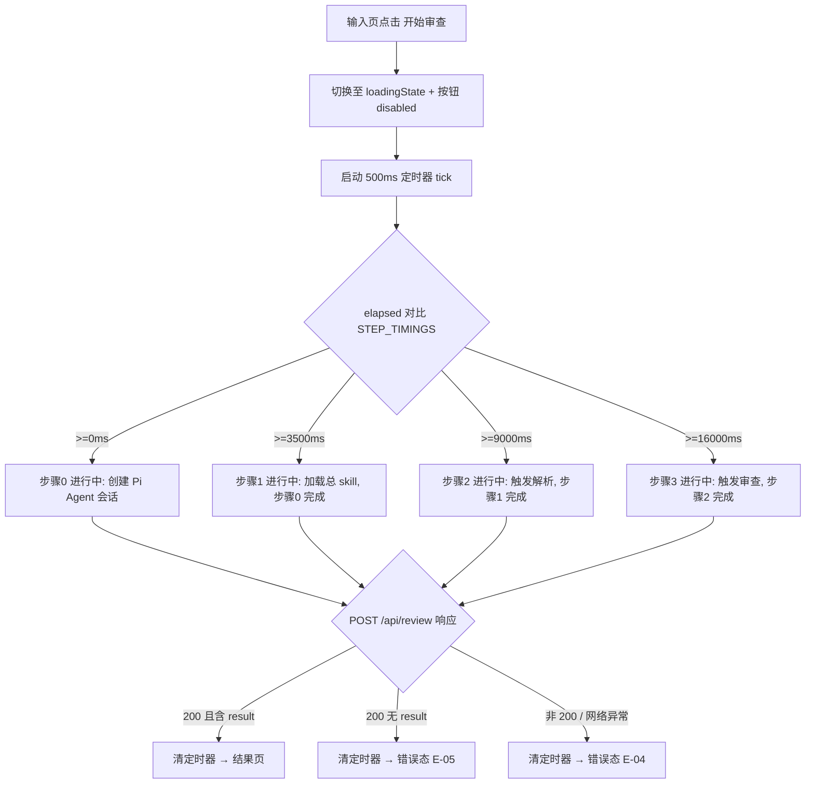

# PRD-02 · 子页面：审查进行中页（加载态 loading）

> 隶属：合同风险审查系统（contract-risk-audit）Web 应用
> 路由：`/`（`#loadingState` 可见态）· 文档版本 v1.0 · 2026-10-26

---

## 1. 页面概述

### 1.1 定位

审查请求发出后、结果返回前的过渡态。承担两个职责：① 明确告知用户「系统正在按 SOP 执行」，消除 1–3 分钟等待期的焦虑与误操作；② 以四步进度可视化总 skill 编排链路（创建会话 → 加载总 skill → 解析 → 审查）。

### 1.2 业务目标与价值

| 编号 | 目标 | 衡量口径 |
|---|---|---|
| G1 | 等待期零误操作 | loading 态期间「开始审查」不可用，重复提交率为 0 |
| G2 | 等待可感知 | 进度条每 500ms 刷新一次，四步状态文案与实际阶段语义一致 |
| G3 | 降低放弃率 | loading 态明确给出「首次执行通常需要 1–3 分钟」预期，等待放弃率 ≤ 10% |

---

## 2. 目标用户与典型使用场景

| 角色 | 场景 |
|---|---|
| 法务专员/业务员 | 提交后等待模型完成两阶段审查（实测约 150s）；期间可阅读四步进度了解 SOP |
| 演示/评审者 | 需要跳过真实等待 → 使用 `?demo=1`（**不经过本页**） |

**不支持场景**：loading 态下二次提交、中途取消（当前版本无取消能力，见 §6 E-08）、后台运行（关闭页面即中断渲染，服务端会话仍会执行完毕但不回传）。

---

## 3. 核心功能清单（分优先级）

| 编号 | 功能 | 优先级 | 接口依赖 | 跳转（源 → 目标） |
|---|---|---|---|---|
| F-01 | 进入 loading 态：脉冲动画 + 标题「正在审查合同…」+ 副标题 | P0 | 无 | 输入页 → 本页 |
| F-02 | 四步进度列表按时间轴推进（创建会话 → 加载总 skill → 解析 → 审查） | P0 | 无（前端模拟时间轴） | 本页内状态自更新 |
| F-03 | 副标题文案同步当前活动步骤 | P0 | 无 | 无 |
| F-04 | 等待时长预期提示（固定文案） | P1 | 无 | 无 |
| F-05 | 请求返回后退出本页：成功 → 结果页；失败 → 错误态 | P0 | `POST /api/review` 响应 | 本页 → 结果页 / 错误态 |
| F-06 | 步骤推进定时器清理（防内存泄漏与错乱回写） | P0 | 无 | 无 |
| F-07 | 真实阶段回传（以服务端事件替换模拟时间轴） | P2 | 未来 SSE/WebSocket | 无 |

**验收标准（可量化）**

- F-01：点击「开始审查」到本页可见 ≤ 100ms（纯 DOM 切换，无网络依赖）。
- F-02：步骤激活时间点为 `0 / 3500 / 9000 / 16000` ms（±500ms 定时器误差）；第 N 步激活时，前 N-1 步状态为「完成」、N 为「进行中」、之后为「等待」；步骤文字（逐字）：
  1. `创建会话 / Session`
  2. `加载 contract-risk-audit 总 skill`
  3. `触发 contract-clause-parser 解析`
  4. `触发 contract-risk-review 审查`
- F-03：副标题（`#loadingSub`）依次为 `创建 Pi Agent 会话` → `加载 contract-risk-audit 总 skill` → `触发 contract-clause-parser 解析` → `触发 contract-risk-review 审查`，与活动步骤严格同步。
- F-05：响应到达（无论成败）后 200ms 内完成状态切换，且 `setInterval` 已被 `clearInterval` 清理（F-06）。
- F-04：固定文案逐字为 `首次执行通常需要 1–3 分钟，请保持页面打开。`

---

## 4. 页面交互流程图

**状态跳转源/目标清单**

| 源 | 目标 | 触发条件 |
|---|---|---|
| 输入页（校验通过） | 本页 | `runReview()` 调用 `startLoading()` |
| 本页 | 结果页（`#resultState`） | 200 且 `data.result` 存在 |
| 本页 | 错误态（`#errorState`） | 非 200 / 网络异常 / `data.result` 缺失 |

---

## 5. 字段与状态规则

| 元素 | ID / 类 | 初始值 | 状态规则 |
|---|---|---|---|
| 脉冲动画 | `.pulse` | 显示 | 纯 CSS，loading 态期间持续 |
| 标题 | `#loadingState h3` | `正在审查合同…` | 静态；`.dots` 为装饰省略号 |
| 副标题 | `#loadingSub` | `创建 Pi Agent 会话` | 每 500ms 随活动步骤更新 |
| 步骤节点 | `.load-step[data-step=0..3]` | step0 = `active`，其余无类 | `active`（进行中）/ `done`（完成）互斥；`em` 文案：完成→`完成`、当前→`进行中`、未到→`等待` |
| 时间轴 | `STEP_TIMINGS` | `[0, 3500, 9000, 16000]` | 毫秒；P2 项：可配置化（`window.__STEP_TIMINGS` 覆写） |
| 提交按钮 | `#runBtn` | `disabled=true`（进入本页前置位） | 请求结束（成功/失败）后 `finally` 恢复 |

---

## 6. 全链路异常处理

| 编号 | 异常 | 触发条件 | 提示文案（逐字） | 处理与降级 |
|---|---|---|---|---|
| E-01 | 服务端执行失败 | `res.ok === false` | `data.error` 或缺省 `服务端执行失败` | 清定时器 → 错误态；错误态提供「重新执行」 |
| E-02 | 结果缺结构化 JSON | 200 但 `!data.result` | `模型返回了文本，但没有找到结构化的 JSON 结果。请查看「审查全文」或重试。` | 清定时器 → 错误态 |
| E-03 | 网络中断 / 超时 | fetch reject | `Failed to fetch`（浏览器原生消息透传） | 清定时器 → 错误态 |
| E-04 | 页面刷新/关闭 | 用户离开 | 无 | 服务端会话继续执行但不回传；P2 项：`beforeunload` 提示「审查仍在进行，离开将看不到结果」 |
| E-05 | 长时间无响应 | >5 分钟未返回 | 无（当前无超时机制） | P1 项：前端 300s 软超时，提示「审查耗时较长，仍在等待服务端结果…」；600s 硬超时进错误态「服务端超时，请重试」 |

**降级原则**：模拟时间轴仅用于体验引导，**不得**因定时器异常阻塞结果渲染；任何响应到达必须先 `clearInterval` 再切态（防止 tick 回写覆盖已切换状态）。

---

## 7. 数据埋点需求（全节点）

| 事件名 | 触发条件 | 上报参数 |
|---|---|---|
| `loading_enter` | `startLoading()` 执行 | `char_count`、`filename`、`ts` |
| `loading_step` | 每次活动步骤切换（0→1→2→3） | `step_index`、`step_label`、`elapsed_ms` |
| `loading_exit` | 请求响应到达并清理定时器 | `outcome`（success/error）、`elapsed_ms`、`error_code`（失败时） |
| `loading_abandon` | loading 态期间页面 `beforeunload` / `visibilitychange→hidden` 且 30s 未回 | `elapsed_ms`（P2，配合 E-04） |

---

## 8. 多端兼容性与性能要求

| 维度 | 要求 |
|---|---|
| 浏览器 | Chrome/Edge ≥ 110、Firefox ≥ 110、Safari ≥ 16（`setInterval`、CSS 动画、`hidden` 属性） |
| 响应式 | 沿用全局断点；步骤列表 ≤1180px 纵向间距压缩，不出现横向滚动 |
| 性能 | 定时器周期 500ms，每 tick 仅做 classList/文案更新，无重排开销（步骤节点固定 4 个）；动画使用 CSS `transform/opacity`，CPU 占用可忽略 |
| 一致性 | 从本页切出（成功/失败）后，页面任何位置不得残留「进行中」状态文案 |
| 电量友好 | 标签页不可见时（`visibilitychange`）定时器暂停（P2 项，`setInterval` 已由浏览器节流，现状可接受） |

---

## 9. 接口依赖明细

| 接口 | 方法 | 入参 | 出参 | 本页消费方式 |
|---|---|---|---|---|
| `/api/review` | POST | `{ contract, filename }` | `{ markdown, result{...}, model, sessionId, skills, toolCalls, elapsed_ms }` | 仅监听完成/失败信号；成功将整个响应对象交给结果页渲染，本页不解析字段 |
| `/api/review`（失败） | POST | 同上 | `{ error: string }` | 取 `error` 字段作为错误态文案；缺失时用缺省文案 |

---

## 10. 边界条件汇总

| 支持场景 | 不支持场景 |
|---|---|
| 正常 1–3 分钟等待、四步模拟进度、等待中按钮防重复提交、响应后自动切出 | 手动取消审查；进度与服务端真实阶段实时对齐（现为模拟时间轴，P2）；后台标签页保证实时推进（浏览器节流）；`?demo=1` 路径（不经过本页） |
