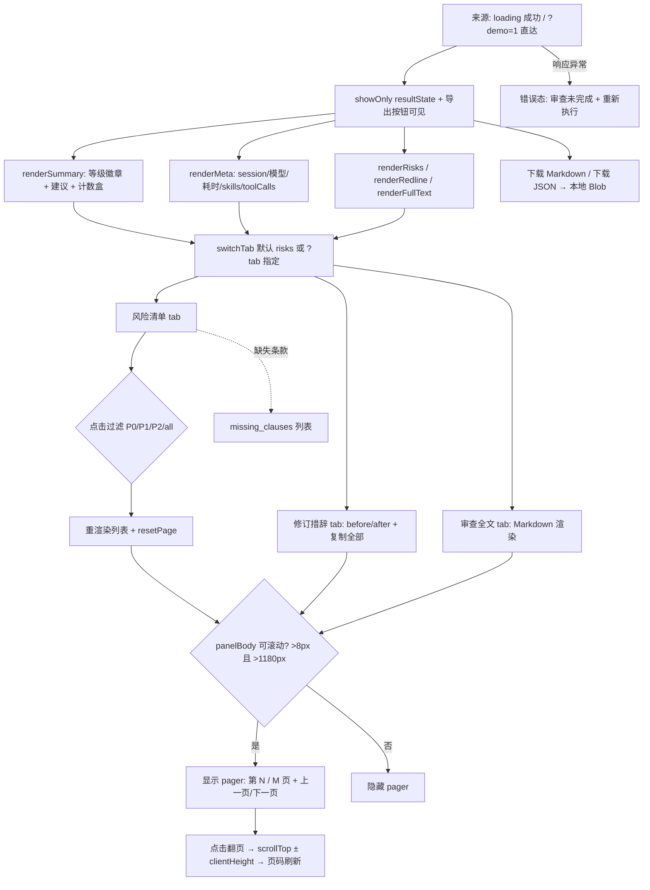

# PRD-03 · 子页面：审查结果页（结果态 result）

> 隶属：合同风险审查系统（contract-risk-audit）Web 应用
> 路由：`/`（`#resultState` 可见态；支持 `/?demo=1&tab=…&filter=…` 直达）· 文档版本 v1.0 · 2026-10-26

---

## 1. 页面概述

### 1.1 定位

审查链路的交付终点。将模型返回的结构化结果渲染为「结论摘要 → 运行元信息 → 三个标签页（风险清单 / 修订措辞 / 审查全文）」，并提供等高分页浏览、等级过滤、复制与导出能力。对应 SOP 的 S5「合并交付」：正文给人看，末尾 JSON 给系统读。

### 1.2 业务目标与价值

| 编号 | 目标 | 衡量口径 |
|---|---|---|
| G1 | 结论 3 秒可读 | 首屏无滚动即可见总体等级、建议（可签/改后签/不签）与 P0/P1/P2 计数 |
| G2 | 每条风险可追溯 | 100% 风险卡展示条款号 + 逐字原文依据；无原文时固定显示「合同未约定」 |
| G3 | P0 可直接谈判 | 修订措辞页 before/after 对照 ≤ 10 条、按 P0→P1→P2 排序，可一键复制 |
| G4 | 长内容可完整浏览 | 超出面板高度时启用分页，页码准确率 100%（无内容裁切丢失） |

---

## 2. 目标用户与典型使用场景

| 角色 | 场景 |
|---|---|
| 法务专员 | 按 P0 过滤逐条核对原文依据；把修订措辞复制进英文修订函 |
| 销售业务员 | 看结论摘要与「可让步度」标签，确定谈判优先级 |
| 系统/平台方 | 「下载 JSON」获取机器可读结果，供下游流程消费 |
| 演示/评审者 | `/?demo=1&tab=redline`、`/?demo=1&filter=P1` 秒开指定画面用于截图 |

**不支持场景**：结果编辑/回写（只读展示）；跨会话历史查询；风险项二次评分；打印样式（P2 规划）。

---

## 3. 核心功能清单（分优先级）

| 编号 | 功能 | 优先级 | 接口依赖 | 跳转（源 → 目标） |
|---|---|---|---|---|
| F-01 | 结论摘要卡：总体等级徽章 + 建议判定 + P0/P1/P2 计数盒 | P0 | 响应 `result` | 无 |
| F-02 | 运行元信息条：session / 模型 / 耗时 / skills / tool calls | P1 | 响应顶层字段 | 无 |
| F-03 | 标签页切换（风险清单 / 修订措辞 / 审查全文） | P0 | 无 | 本页内切换 |
| F-04 | 风险清单：等级过滤（全部/P0/P1/P2，含计数徽标） | P0 | 无 | 本页内过滤 |
| F-05 | 风险卡：条款号、类别、可让步度、风险点、原文依据、修改建议 | P0 | 无 | 无 |
| F-06 | 缺失条款提醒区（`missing_clauses`） | P0 | 无 | 无 |
| F-07 | 修订措辞：before/after 对照（≤10 条，P0→P1→P2 排序） | P0 | 无 | 无 |
| F-08 | 复制全部措辞（Clipboard API，2.6s 后恢复按钮文案） | P1 | 无 | 无 |
| F-09 | 审查全文：Markdown 渲染（标题/表格/列表/引用/代码块/行内样式） | P0 | 无 | 无 |
| F-10 | 等高分页：右栏高度=左栏，超出部分「上一页/下一页」翻页 | P0 | 无 | 本页内 |
| F-11 | 下载 Markdown / 下载 JSON | P1 | 无（本地 Blob） | 无 |
| F-12 | URL 参数直达（`?demo=1` `?tab=` `?filter=`） | P1 | `GET /api/demo-result` | 输入页 → 本页 |
| F-13 | 面板高度同步（ResizeObserver + window resize） | P1 | 无 | 无 |

**验收标准（可量化）**

- F-01：`overall_level` 缺失时回退规则 = 有 P0 计 `P0`，否则有 P1 计 `P1`，否则 `P2`；`recommendation` 缺失回退 `revise`（文案「改后签」）；映射固定：`sign→可签/SIGN`、`revise→改后签/REVISE`、`reject→不签/REJECT`；`summary` 缺失时回退为模板文案 `共识别 {n} 项风险，其中 P0 {p0} 项。建议{建议}，P0 条款签署前必须修改。`。四个过滤徽标计数 = risks 数组按 `level` 统计，与摘要计数盒完全一致。
- F-03：非法 `?tab=` 值一律回退 `risks`；激活 tab 按钮带 `active` 类，且其余两个面板 `hidden=true`。
- F-04：点击过滤后 100ms 内列表重渲染；过滤为 `all` 显示全部；其他值精确匹配 `r.level`；该等级为空时显示逐字文案 `该等级下没有风险项。`
- F-05：`clause` 为 `"-"` 或空 → 条款号固定显示 `合同未约定`，否则 `第 {clause} 条`；`evidence` 缺失 → 原文依据区显示 `合同未约定`；`negotiability` 映射：`must-change→必须修改`、`preferred→优先谈判`、`acceptable→可接受`，未知值原样展示；所有文本入库前经 `escapeHtml` 转义（XSS 防护）。
- F-07：仅收录含 `suggestion` 的风险；排序权重 `{P0:0, P1:1, P2:2, 未知:3}` 稳定排序；最多展示 10 条（`slice(0,10)`）。
- F-08：复制成功 → 按钮文案 `已复制`，1600ms 后恢复 `复制全部措辞`；失败 → `复制失败`（不恢复倒计时，用户可重试）。复制文本格式（逐字模板）：`[{level}] Clause {clause} · {category}\nISSUE: {issue}\nCURRENT: {evidence}\nPROPOSED: {suggestion}`，条目间以空行分隔。
- F-10：分页可见条件（全部满足才显示）：结果态可见 且 `scrollHeight - clientHeight > 8` 且 视口 >1180px；总页数 = `ceil(maxScroll/clientHeight) + 1`；当前页 = `min(pages, round(scrollTop/clientHeight) + 1)`；页码文案 `第 {page} / {pages} 页`；`scrollTop ≤ 2` 时「上一页」禁用，`scrollTop ≥ maxScroll - 2` 时「下一页」禁用；单次翻页位移 = ±`clientHeight`；滚动时页码实时刷新（passive 监听）。
- F-11：Markdown 文件名 `{baseName}-risk-review.md`（MIME `text/markdown;charset=utf-8`），JSON 文件名 `{baseName}-risk-review.json`（`application/json;charset=utf-8`，内容为完整响应对象、2 空格缩进）；`baseName` = `filename` 去除 `.md/.txt/.markdown` 后缀；`markdown` 为空时「下载 Markdown」点击无动作。
- F-12：`?demo=1` 存在 → 拉取 `/api/demo-result` 渲染，`error` 字段存在则进错误态；`?filter=` 仅接受 `P0/P1/P2`，非法值忽略并保持默认 `all`。

---

## 4. 页面交互流程图



**状态跳转源/目标清单**

| 源 | 目标 | 触发条件 |
|---|---|---|
| 审查进行中页 / `?demo=1` | 本页 | 响应 200 且含 `result` |
| 本页 · tab `risks` | tab `redline` / `fulltext` | 点击对应 `.tab` 按钮 |
| 本页 | 错误态（`#errorState`） | 仅 demo 模式拉取失败；正常审查的失败发生在 loading 态 |
| 本页 · 顶部品牌块 | 输入页（整页刷新） | `href="/"` |

---

## 5. 字段与渲染规则（数据契约）

### 5.1 响应顶层字段

| 字段 | 类型 | 必需 | 渲染规则 |
|---|---|---|---|
| `markdown` | string | 否 | 审查全文 tab 的渲染源；空 → 逐字文案 `模型未返回可展示的文本。` |
| `result` | object | **是**（缺失进错误态） | 见 5.2 |
| `model` | string | 否 | 元信息 chip |
| `sessionId` | string | 否 | chip 显示前 18 字符 + `…`；页脚显示前 8 字符，缺省 `尚无会话` |
| `skills` | string[] | 否 | 逐个渲染 `skill · {name}` chip |
| `toolCalls` | array | 否 | 非空时渲染 `{length} tool calls` chip |
| `elapsed_ms` | number | 否 | 渲染 `(ms/1000).toFixed(1)s` |

### 5.2 `result` 结构

| 字段 | 类型 | 缺省回退 | 消费位置 |
|---|---|---|---|
| `overall_level` | `"P0"|"P1"|"P2"` | 按计数回退（§3 F-01） | 摘要徽章 |
| `recommendation` | `"sign"|"revise"|"reject"` | `revise` | 摘要判定（中文 + OVERALL RISK 英文） |
| `summary` | string | 模板文案（§3 F-01） | 摘要正文 |
| `risks[]` | array | `[]` | 三个 tab 共用数据源 |
| `risks[].level` | `"P0"|"P1"|"P2"` | 未知值原样展示 | 徽章 / 过滤 / 排序 |
| `risks[].clause` | string | `"-"`/空 → `合同未约定` | 条款号 |
| `risks[].category` | string | 空串 | 类别 |
| `risks[].negotiability` | `must-change/preferred/acceptable` | 未知原样 | 可让步度标签 |
| `risks[].issue` | string | 空串 | 风险点标题 / redline 的 why 行 |
| `risks[].evidence` | string | `合同未约定` | 原文依据引用块 / redline 的 CURRENT |
| `risks[].suggestion` | string | 空串（redline 中被过滤） | 修改建议 / redline 的 PROPOSED |
| `missing_clauses[]` | string[] | `[]` | 非空时渲染「缺失条款提醒 · MISSING CLAUSES」列表，空时整块隐藏 |

### 5.3 Markdown 渲染白名单（`renderMarkdown`）

| 语法 | 渲染 | 说明 |
|---|---|---|
| ```` ```lang ```` 代码块 | `<pre><code data-lang>` | 内容整体转义 |
| 管道表格 | `<table>` | 首行为表头，第 2 行分隔符跳过 |
| `#{1,4}` 标题 | `<h1>–<h4>` | |
| `>` 引用 | `<blockquote>` | 连续引用合并 |
| `-`/`*` 无序、`1.`/`1)` 有序列表 | `<ul>/<ol>` | 相邻同类合并 |
| 行内 `` ` ``/`**`/`[text](url)` | `<code>/<strong>/<a>` | 链接固定 `target="_blank" rel="noreferrer"` |
| 其余行 | `<p>` | 连续非空行合并为一段 |

---

## 6. 全链路异常处理

| 编号 | 异常 | 触发条件 | 提示文案（逐字） | 处理与降级 |
|---|---|---|---|---|
| E-01 | demo 数据缺失 | `?demo=1` 且接口失败/含 `error` | `演示结果未就绪：{原因}` | 切错误态，保留「重新执行」 |
| E-02 | 空风险列表（过滤后） | 当前等级计数为 0 | `该等级下没有风险项。` | 保持过滤态可切换；不影响其他 tab |
| E-03 | markdown 为空 | `data.markdown` 为空串/undefined | `模型未返回可展示的文本。` | 风险清单/修订措辞 tab 不受影响 |
| E-04 | 剪贴板权限拒绝 | `navigator.clipboard.writeText` reject | 按钮文案 `复制失败` | 保留 before/after 对照可手动选择复制；不弹系统弹窗 |
| E-05 | 无可导出内容 | `state.data` / `markdown` 为空 | 无 | 点击导出按钮无动作（按钮仅在结果态可见，正常情况下数据已就绪） |
| E-06 | 渲染期数据异常 | `risks` 非 array | 按 `[]` 处理 | 计数盒显示 0，不抛错阻塞整页 |
| E-07 | 分页尺寸抖动 | 窗口 resize / 字体晚到导致高度变化 | 无 | `ResizeObserver`（观察左栏）+ `resize` + `scroll`（passive）三路触发 `syncPanelHeight`/`updatePager` 重算 |

**降级原则**：单 tab 数据异常不阻塞整页渲染；结构化 `result` 缺失是唯一整页失败条件（进错误态）。

---

## 7. 数据埋点需求（全节点）

| 事件名 | 触发条件 | 上报参数 |
|---|---|---|
| `result_view` | `renderResult()` 完成 | `elapsed_ms`、`model`、`risk_count`、`p0/p1/p2`、`overall_level`、`recommendation`、`source`（live/demo）、`session_id` |
| `tab_switch` | `switchTab()` 且 tab 实际变化 | `from_tab`、`to_tab` |
| `filter_change` | 点击过滤按钮 | `level`（all/P0/P1/P2）、`visible_count` |
| `risk_expand_view` | 风险卡进入视口（IntersectionObserver，P2） | `risk_index`、`level`、`clause` |
| `redline_copy` | 复制全部措辞 | `copied_count`、`success`（bool） |
| `export_md` / `export_json` | 对应下载点击 | `filename`、`size_bytes` |
| `pager_turn` | 上一页/下一页点击 | `direction`（prev/next）、`page`、`pages` |
| `demo_load` / `demo_load_fail` | demo 结果渲染成功/失败 | `error`（失败时） |

---

## 8. 多端兼容性与性能要求

| 维度 | 要求 |
|---|---|
| 浏览器 | Chrome/Edge ≥ 110、Firefox ≥ 110、Safari ≥ 16；Clipboard API 需 HTTPS 或 localhost（当前满足），失败走 E-04 |
| 响应式 | >1180px：双栏等高 + 分页；≤1180px：右栏高度释放为自适应、分页禁用（`matchMedia("(max-width:1180px)")`），内容自然滚动 |
| 渲染性能 | 结果渲染一次性完成（≤ 200ms / 16 条款规模）；Markdown 渲染为纯字符串拼接，无第三方库；过滤/切 tab 仅重渲染目标区域 |
| 高度同步 | 右栏 `style.height` = 左栏 `offsetHeight` px；同步时机：渲染完成、resize、左栏尺寸变化（ResizeObserver） |
| 安全 | 全部动态文本经 `escapeHtml`；Markdown 行内链接仅 `http(s)` 由模型产出，`rel="noreferrer"` |
| 数据量边界 | 风险条数 ≤ 50、markdown ≤ 200KB 内流畅；超出范围允许渲染耗时线性增长（P2：虚拟列表） |

---

## 9. 接口依赖明细

| 接口 | 方法 | 入参 | 出参（本页消费） | 失败语义 |
|---|---|---|---|---|
| `/api/review`（由 loading 页转发响应） | POST | `{ contract, filename }` | `{ markdown, result{overall_level, recommendation, summary, risks[], missing_clauses[]}, model, sessionId, skills[], toolCalls[], elapsed_ms }` | 本页不直接调用；`result` 缺失由 loading 页拦截 |
| `/api/demo-result` | GET | 无（URL 带 `?demo=1`） | 同上结构，或 `{ error }` | 含 `error`/失败 → E-01 |

> 下游系统可直接复用 `POST /api/review` 的 `result` JSON（与「下载 JSON」文件内容一致），实现与 Web 解耦的程序化消费。

---

## 10. 边界条件汇总

| 支持场景 | 不支持场景 |
|---|---|
| 16–50 条款规模结果展示；三 tab 切换；等级过滤；before/after ≤10 条复制；双格式导出；等高分页；URL 直达（demo/tab/filter） | 结果编辑与回写；Redline 超 10 条全量展示（截断为前 10，需全量走「下载 Markdown」）；≤1180px 下的分页（退化为自然滚动）；无 `result` 的纯文本响应渲染为结构化卡片；历史会话回看 |
