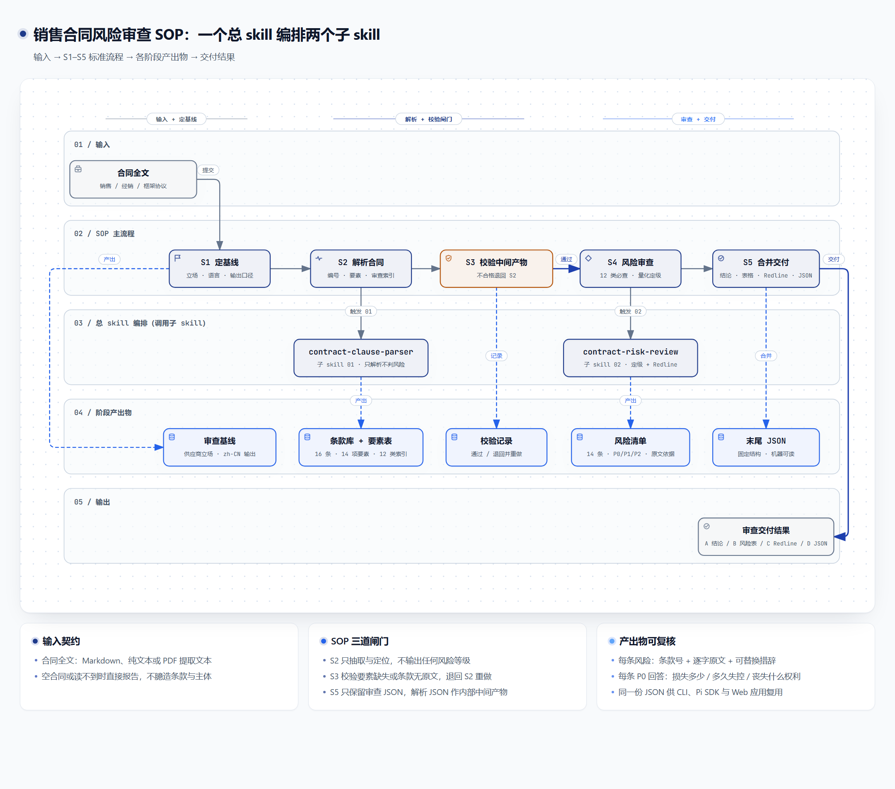

# 交付说明 · 课题 2：销售合同的风险审查与条款核对

> Day2 Skill 落地实现 · 沃泰能源（Voltai Energy Storage）
> 全部文件位于本仓库根目录；命令统一在仓库根目录执行。

## 0. 一句话

把「合同审查」封装成**一个总 skill + 两个子 skill**：总入口 `contract-risk-audit` 负责编排，顺序触发 `contract-clause-parser`（解析成可引用的结构化事实）与 `contract-risk-review`（按量化阈值判风险）。并在三种运行方式下验证：kimi-code CLI、Pi Agent SDK、以 Pi Agent 为底座的 Web 应用。

---

## 1. 目录结构

```
voltai-contract-guard/
├─ skills/                            # 任务 1：1 个总 skill + 2 个子 skill
│  ├─ contract-risk-audit/SKILL.md             # 总入口：编排 / 校验 / 合并
│  ├─ contract-clause-parser/SKILL.md          # 子 skill 1：解析
│  └─ contract-risk-review/                    # 子 skill 2：审查
│     ├─ SKILL.md
│     └─ references/scoring-rubric.md
├─ docs/                              # 合同、设计理念图、PRD、执行截图
│  ├─ contracts/                      # 样本 A（高风险）/ 样本 B（相对平衡）
│  ├─ design/skill-design-concept.{html,png}
│  ├─ prd/                            # 4 份 PRD
│  └─ screenshots/                    # CLI、Pi SDK、应用截图 + 原始运行日志
├─ examples/
│  └─ pi-sdk-ingest/                  # 任务 2：Pi Agent SDK 测试
│     ├─ test.mjs
│     ├─ .pi/skills/llm-wiki/         # 第三方 skill（MIT，见其 README）
│     ├─ docs/sample-source.md        # 待录入的知识文档
│     └─ raw/  wiki/                  # 入库产物
├─ app/                               # 任务 3：前后端应用
│  ├─ server.mjs                      # Pi Agent SDK 后端
│  ├─ public/                         # 原生 HTML/CSS/JS 前端
│  └─ data/demo-result.json           # 真实执行后缓存的审查结果
└─ package.json
```

---

## 2. 任务 1：可执行 skill（非 demo）

### 2.1 为什么是「一个总 skill + 两个子 skill」



设计理念图用 `archify` 的 workflow 类型生成（产物 `docs/design/skill-design-concept.html`，四道质量闸门 validate / deliver / check / browser-check 全部通过），自上而下五条泳道分别承载**输入 → S1–S5 标准 SOP → 总 skill 编排 → 各阶段产出物 → 输出**；配色取 `ui-ux-pro-max` 的 Legal Services「Trust & Authority」体系（深蓝 #1E3A8A / 蓝 #1E40AF / 浅底 #F8FAFC / 边框 #CBD5E1，琥珀 #B45309 仅用于校验闸门与风险提示），与 Web 应用界面同源。

> 这两个辅助 skill（`archify` / `ui-ux-pro-max`）属于外部工具，未随本仓库发布；仓库中保留生成后的设计图与设计规范说明。

- **单一入口**：用户只需说「审查这份合同」，由 `contract-risk-audit` 统一决定跑哪两步，不依赖用户自己记得顺序。
- **单一职责**：解析不判风险，审查不改写原文，避免"一边读一边猜"；两个子 skill 仍可被单独复用。
- **总 skill 只做三件事**：编排（按序触发）、校验（中间产物不合格就重做）、合并（只输出一份最终答复）。
- **原文可追溯**：每条风险必须带条款号 + 逐字原文；没有约定就写「合同未约定」。
- **量化定级**：P0/P1/P2 只看金额、时限、权利丧失，阈值固化在 `references/scoring-rubric.md`。
- **契约化输出**：正文给人看，末尾固定 JSON 给程序看（CLI / SDK / 前端共用）。

### 2.2 Skill 清单与编排关系

```
contract-risk-audit（总入口）
   ├─ 01 → ../contract-clause-parser/SKILL.md     解析，不判风险
   └─ 02 → ../contract-risk-review/SKILL.md       审查 + references/scoring-rubric.md
```

| Skill | 角色 | 职责 | 关键产物 |
|---|---|---|---|
| `contract-risk-audit` | 总 skill | 定基线 → 触发解析 → 校验中间产物 → 触发审查 → 合并输出与自检 | 一份最终答复（A 结论 / B 风险表 / C Redline / D 末尾 JSON） |
| `contract-clause-parser` | 子 skill 1 | 识别元信息、切分并编号条款、抽取 14 项商务要素、建立 12 类审查索引 | `contract` / `clauses[]` / `facts{}` / `category_index{}`（内部中间产物） |
| `contract-risk-review` | 子 skill 2 | 12 类必查（已约定 / 缺失 / 不对等）、量化定级、给可替换措辞 | 结论摘要 / 风险明细表 / Redline / 末尾 JSON |

两个子 skill 的 `description` 均标注「由 contract-risk-audit 总 skill 编排调用」，避免模型把子 skill 当平级入口重复触发。`contract-risk-review` 通过 `references/scoring-rubric.md` 按需加载定级锚点，实现渐进披露。

三个目录是平级的（不是物理嵌套）：Pi Agent SDK 与 kimi-code 的 skill 发现规则是「目录内有 `SKILL.md` 即为 skill root，不再向下递归」，物理嵌套会导致两个子 skill 不被独立加载。因此总 skill 用相对路径（`../contract-clause-parser/SKILL.md`）显式引用子 skill，实现逻辑封装。

### 2.3 kimi-code CLI 执行证据

```powershell
kimi --skills-dir skills -p "<合同审查提示词>"
```

- 终端截图：[kimi-cli.png](screenshots/kimi-cli.png)
- 完整原始输出（1000 行，总 skill 编排版）：[kimi-cli-run-master.txt](screenshots/kimi-cli-run-master.txt)
- 旧版（两个平级 skill 直接触发）：[kimi-cli-run.txt](screenshots/kimi-cli-run.txt)

运行日志可见编排过程：先读总 skill，再按序读两个子 skill（`Let me read the contract and the two sub-skills`），最后合并输出。样本 A 结果：

- 16 条条款 / 14 项商务要素（3 项「未约定」）/ 12 类必查项全覆盖
- 14 条风险：**12 P0 / 1 P1 / 1 P2**，总体等级 P0，结论「改后签」，须先改 12 条
- Redline C1/C2，末尾唯一 JSON（`clause_count: 16`、`checked_categories: 12`）

---

## 3. 任务 2：Pi Agent + llm-wiki skill 入库

### 3.1 环境

- Pi Agent SDK：`@earendil-works/pi-coding-agent` 1.4.0（全局安装）
- 登录：`pi` 内 `/login`，凭证保存在 `~/.pi/agent/auth.json`（不随仓库提交）
- 运行模型：`deepseek/deepseek-flash`

### 3.2 测试脚本做了什么

[test.mjs](../examples/pi-sdk-ingest/test.mjs) 用 SDK 在指定目录加载 `llm-wiki` skill：

1. `DefaultResourceLoader` + `additionalSkillPaths` 指向 `examples/pi-sdk-ingest/.pi/skills/llm-wiki`；
2. `skillsOverride` 只保留该目录下的 skill，避免被其他 skill 干扰；
3. `ModelRuntime.create()` → 选 deepseek 模型；
4. `createAgentSession()` 创建会话（`inMemory`），执行 llm-wiki 的 Ingest 流程。

```powershell
npm run example:ingest
```

（等价于 `node examples/pi-sdk-ingest/test.mjs`。）

### 3.3 入库结果

输入：`examples/pi-sdk-ingest/docs/sample-source.md`（工商业储能峰谷套利）

- `raw/energy-storage/industrial-commercial-storage-peak-valley-arbitrage.md`
- `wiki/energy-storage/industrial-commercial-storage-arbitrage.md`
- `wiki/index.md`、`wiki/log.md` 已更新
- 自检：`check_evidence.py` → 0 fidelity suspects · 0 evidence errors · 0 unreferenced raw files

证据：[pi-sdk.png](screenshots/pi-sdk.png) ｜ 原始输出：[pi-sdk-run.txt](screenshots/pi-sdk-run.txt)

---

## 4. 任务 3：以 Pi Agent 为底座的应用

### 4.1 架构

```
浏览器（原生 HTML/CSS/JS）
   │  POST /api/review
   ▼
Node http server（app/server.mjs）
   │  DefaultResourceLoader → 加载 skills 目录下 3 个 skill（白名单）
   │  ModelRuntime           → deepseek/deepseek-v4-pro
   │  createAgentSession()   → 以 contract-risk-audit 为入口，触发两个子 skill
   ▼
markdown + 结构化 JSON → 前端渲染风险卡 / Redline / 全文 / 原始 JSON
```

后端用 `SKILL_NAMES` 白名单只放行 `contract-risk-audit`、`contract-clause-parser`、`contract-risk-review`，避免同一目录下其他来源的 skill 干扰；`buildPrompt` 明确入口唯一、必须按序触发两个子 skill、不得跳步。

### 4.2 接口

| 方法 | 路径 | 用途 |
|---|---|---|
| GET | `/api/health` | 健康检查，返回模型与已加载 skill |
| GET | `/api/samples` | 返回两份模拟合同全文 |
| GET | `/api/demo-result` | 返回真实执行后缓存的结果 |
| POST | `/api/review` | 入参 `{contract, filename}`，返回 `{markdown, result, model, sessionId, skills, toolCalls, elapsed_ms}` |

会话文件默认落到系统临时目录（`SESSION_DIR` 可覆盖），避免运行账户对项目目录无写权限时失败。

### 4.3 启动

```powershell
npm install          # 首次，安装 @earendil-works/pi-coding-agent
npm start            # 或 node app/server.mjs
# 打开 http://localhost:4311
```

### 4.4 应用截图

| 截图 | 内容 |
|---|---|
| [app-01-home.png](screenshots/app-01-home.png) | 首页：样本合同、合同原文、执行入口 |
| [app-02-risks.png](screenshots/app-02-risks.png) | 审查结果：P0 结论、P0/P1/P2 计数、风险卡与原文依据 |
| [app-03-redline.png](screenshots/app-03-redline.png) | 修订措辞：原文 / 替换句 before-after 对照 |
| [app-04-filter-p1.png](screenshots/app-04-filter-p1.png) | 按等级过滤（P1） |
| [app-05-fulltext.png](screenshots/app-05-fulltext.png) | 审查全文：模型返回的完整 Markdown 报告 |

结果面板与左侧输入面板**等高**，内容超出时在面板内滚动，用底部的「上一页 / 下一页」分页浏览；原始 JSON 标签页已移除，机器可读结果仍可通过右上角「下载 JSON」导出。

截图中的结果来自一次真实执行：入口 `contract-risk-audit`，加载 3 个 skill，模型 `deepseek/deepseek-v4-pro`，14 项风险（11 P0 / 3 P1 / 0 P2），耗时约 152.7 秒，会话 `01a17271-…`。缓存文件：[demo-result.json](../app/data/demo-result.json)。

### 4.5 界面设计规范

前端按 `ui-ux-pro-max` 的 Legal Services「Trust & Authority」设计系统重构，与设计理念图共用同一套色板：

| 角色 | 色值 | 用法 |
|---|---|---|
| Primary | `#1E3A8A` | 品牌块、主按钮、标题强调、结论卡底色 |
| Secondary | `#1E40AF` | 渐变、链接态、修复建议文字 |
| Background / Card | `#F8FAFC` / `#FFFFFF` | 页面底色 / 内容卡片 |
| Foreground | `#0F172A` | 正文与标题 |
| Muted / Border | `#64748B` / `#CBD5E1` | 次级信息 / 分隔线 |
| Destructive | `#DC2626` | P0 |
| Warning | `#B45309` | P1、缺失条款、S3 校验闸门 |

字体为 Plus Jakarta Sans（拉丁）+ PingFang SC / Microsoft YaHei（中文），标题统一无衬线、字重 700–800，去掉原米色底与青绿主色；P2 由青绿改为蓝色，使 P0/P1/P2 形成「红 → 琥珀 → 蓝」的单一语义阶梯。布局（402px 左栏 + 结果区、四个 Tab、风险卡、Redline 对照、JSON 面板）保持不变。


---

## 5. 复现路径

1. `npm install`（根目录，已含 `@earendil-works/pi-coding-agent`）
2. `npm run example:ingest` —— 任务 2：llm-wiki 入库
3. `kimi --skills-dir skills -p "..."` —— 任务 1：CLI 审查
4. `npm start` + 打开 `http://localhost:4311` —— 任务 3：应用
   - `?demo=1` 直接加载缓存结果；`?demo=1&tab=redline` 等用于复现截图

---

## 6. 说明与边界

- 合同、主体、金额均为模拟数据，仅用于演示 skill 能力。
- skill 输出为商务风险初筛，不构成法律意见；P0 条款签署前应由执业律师复核。
- 仓库不含任何模型凭证；`auth.json` 只在 Pi 用户目录或临时目录中使用。
